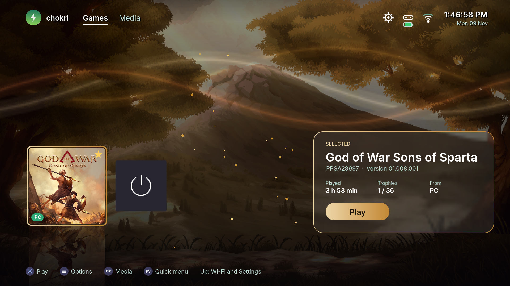

<h1 align="center"></h1>

<p align="center">
  
  
  <a href="LICENSE"></a>
  <a href="https://github.com/blue0x1/EmuFive/releases"></a>
</p>

<p align="center">
  <a href="README.md">EN</a> · <a href="README.ar.md">AR</a> · <b>ZH</b> · <a href="README.fr.md">FR</a> · <a href="README.es.md">ES</a> · <a href="README.de.md">DE</a> · <a href="README.it.md">IT</a> · <a href="README.pt-BR.md">PT</a> · <a href="README.tr.md">TR</a>
</p>

在 PS4 上运行的 PS5 模拟器。

作者：**[Chokri Hammedi (blue0x1)](https://github.com/blue0x1)**。基于 [PS4 Multiboot](https://github.com/blue0x1/ps4-multiboot) 构建。

> **状态：实验性研究。** 在 PS4 Pro 上，《Sons of Sparta》可以达到约 40 FPS 或更高。KytyPS5 会改写游戏代码中 PS5 专有的 CPU 指令（补丁 `0004`）。其他游戏仍在测试中，目前很多运行较慢。请参阅 [CPU 问题](#the-cpu-problem)。

<p align="center"></p>

<p align="center">
  <b><a href="#installing">安装</a></b> · <b><a href="#games">游戏</a></b> · <b><a href="#changelog">更新日志</a></b> · <a href="#how-it-works">工作原理</a> · <a href="#the-cpu-problem">CPU 问题</a> · <a href="#plan">计划</a> · <a href="#building">构建</a> · <a href="#credits">致谢</a>
</p>

<a id="how-it-works"></a>
## 工作原理

- **[PS4 Multiboot](https://github.com/blue0x1/ps4-multiboot)** 在 PS4 上启动 Linux，并用手柄把 Linux 系统安装到 PS4 的内置硬盘上。
- **PS4 Mesa** 是 PS4 Multiboot 的一部分，为 PS4 的 GPU（PS4 和 Slim 上的 Liverpool，Pro 上的 Gladius）提供 Vulkan 1.3。KytyPS5 需要稀疏资源（sparse resources），RADV 在这款 GPU 上通过 `RADV_EXPERIMENTAL=sparse` 提供。
- **KytyPS5**：上游代码固定在某个提交，加上本项目的补丁（`patches/kytyps5/`），使用 `-march=btver2` 为 PS4 的 AMD Jaguar CPU 编译。官方版本使用 AVX2，在 PS4 上会以 "Illegal instruction" 停止。
  - `0001`：构建选项 `KYTY_HOST_ARCH`（模拟器编译的目标 CPU）。
  - `0002`：为自制程序（homebrew）提供的 C 库。用 ps5-native-app-boilerplate 构建的 PS5 自制程序自带一个替身模块 `sce_module/libc.prx`，其中所有函数都返回 0（主机使用自己的 C 库），因此在 KytyPS5 中它的 `malloc` 会失败。该补丁加入了这类自制程序导入的 C 库函数，并且只对这种替身模块使用。
  - `0003`：更多自制程序支持：文件和文件夹、系统调用、前台用户，以及额外的挂载点（`KYTY_MOUNTS`）。
  - `0004`：在 PS4 的 CPU 上运行 PS5 代码。模块加载时，每条 AVX2、FMA 和 BMI2 指令都会被改写为 SSE4.2/AVX/BMI1 代码；无法在加载时改写的指令会在第一次运行时被替换。请参阅 [CPU 问题](#the-cpu-problem)。
- **EmuFive** 把这一切打包成一个小型 Linux 系统，开机直接全屏进入模拟器，没有桌面。它和其他系统一样通过 PS4 Multiboot 安装。

<a id="the-cpu-problem"></a>

## CPU 问题

KytyPS5 并不模拟 PS5 的 CPU：它直接运行游戏自己的 x86-64 代码。PS5 游戏是为 PS5 的 Zen 2 CPU 编译的，到处使用 AVX2、BMI2 和 FMA 指令。PS4 的 Jaguar CPU 一条都没有，所以游戏代码会在遇到第一条这样的指令时停止。

补丁 `0004` 把这一功能加入了 KytyPS5 的客户机指令修补器。当主机 CPU 缺少 AVX2、FMA 或 BMI2 时，每条这样的指令都会被替换为效果相同的代码：256 位整数运算拆成两个 128 位的半部分，跨半部分的置换用 AVX 移动和混合指令完成，逐元素移位一个元素一个元素地做，FMA 用双精度计算，gather 一个元素一个元素地做，BMI2 则保存寄存器后执行。跳转到替换代码的指令写在原指令的位置；如果一条指令太短放不下跳转，又位于修补器无法重新排列的位置，它会触发异常并在运行时被替换。

`tools/jaguar-test/` 在拥有这些指令的 PC 上检查每一个替换：它取出程序代码中出现的每种指令形式，从相同的随机状态分别运行原指令和替换代码，并比较所有寄存器、标志和内存。目前测试过的程序中出现的指令形式全部一致：God of War Sons of Sparta 中有 287 种（包括 gather 和 VFMADDSUB），之前测试的程序中有 227 种。例外是 FMA 中罕见的最后一位差异（单精度会舍入两次，双精度是先乘后加），以及 0 乘以无穷大的一个 NaN 边界情况。

Jaguar 仍然比 PS5 的 CPU 慢得多，替换代码还会增加开销，所以即使游戏能运行，也可能运行得很慢。

<a id="plan"></a>
## 计划

| 步骤 | 状态 |
|---|---|
| PS4 GPU 上的 Vulkan 满足 KytyPS5 的要求 | 完成（`RADV_EXPERIMENTAL=sparse`） |
| 为 PS4 的 CPU 编译 KytyPS5 | 完成（`KYTY_HOST_ARCH=btver2`） |
| KytyPS5 在 PS4 上启动并初始化 GPU | 完成，PS4 Pro |
| EmuFive 系统镜像，通过 PS4 Multiboot 安装 | 完成，PS4 Pro |
| 不使用 AVX2 的 PS5 自制程序能运行并绘制画面 | 完成：为 btver2 重新编译的 Snes9x PS5 2.11，PS4 Pro |
| 手柄、`/data` 和 USB 存储、在该程序中加载游戏 | 已在 PC 测试版本上完成（相同补丁）；接下来是 PS4 |
| 游戏代码的 AVX2、BMI2 和 FMA 转换 | 完成（`0004`），已在 PC 上验证 |
| PS5 游戏在 PS4 上运行 | 完成：God of War Sons of Sparta，约 40 FPS 或更高，PS4 Pro |
| Hollow Knight: Silksong 在 PS4 上运行 | 自 1.0.1 起完成（补丁 `0006` 和 `0007`），PS4 Pro |
| 主屏幕：用手柄选择游戏；Wi-Fi；设置 | 完成，已在 PC 上验证 |
| 从 USB 硬盘、PS4 硬盘或 PC 共享文件夹运行游戏 | 完成，已在 PC 上验证；接下来是 PS4 |

<a id="building"></a>

## 构建

需要 Docker、git，以及来自 PS4 Multiboot 的 PS4 Mesa（`../PS4-Multiboot/out/ps4-mesa.tar.xz`，在那里用 `make mesa` 构建）。`build-kyty.sh` 第一次会把 KytyPS5 克隆到 `build/kytyps5`，之后每次构建都会把它重置到固定的提交并应用补丁。

```bash
scripts/build-kyty.sh      # out/kytyps5-ps4.tar.xz
scripts/build-rootfs.sh    # out/ps5-ps4-rootfs.tar.xz
```

`PS4_MESA` 和 `KYTY` 可以让 `build-rootfs.sh` 使用其他路径。

<a id="installing"></a>

## 安装

EmuFive 和其他 Linux 系统一样，通过 [PS4 Multiboot](https://github.com/blue0x1/ps4-multiboot) 安装。

你需要：

- 一台已破解并装有 **GoldHEN** 的 PS4（用于它的 FTP 服务器和 payload 加载器）。
- 一台在同一网络中、装有 FTP 客户端（例如 FileZilla）的 PC。
- PS4 上约 28 GB 的可用空间（16 GB 的磁盘，再加上始终为 PS4 保留的 10 GB），或者一个 8 GB 及以上的 USB 硬盘。
- 一个 DualShock 4 手柄（用 USB 线连接，或之后通过蓝牙配对）。

步骤：

1. 从 [PS4 Multiboot 发布页](https://github.com/blue0x1/ps4-multiboot/releases) 下载 `bzImage`、`initramfs.cpio.gz`、`bootargs.txt` 和 `linux-2048mb.bin`。（不需要 `ps4-mesa.tar.xz`：EmuFive 已内置 PS4 Mesa。）
2. 从 [EmuFive 发布页](https://github.com/blue0x1/EmuFive/releases) 下载 `ps5-ps4-rootfs.tar.xz`（或者自己构建，见 [构建](#building)）。不要改名：PS4 Multiboot 通过文件名中的 `-ps4-rootfs` 识别系统。
3. 打开 GoldHEN 的 FTP 服务器，把文件复制到 PS4（端口 2121）：

   | 文件 | PS4 上的文件夹 |
   |---|---|
   | `bzImage`、`initramfs.cpio.gz`、`bootargs.txt` | `/data/linux/boot/` |
   | `ps5-ps4-rootfs.tar.xz` | `/user/home/` |
   | `linux-2048mb.bin` | `/data/payloads/` |

4. 在 GoldHEN 的 payload 菜单中运行 `linux-2048mb.bin`。

   > **请耐心等待：** payload 启动后，Linux 启动期间电视可能会 **显示 "No signal" 或黑屏 1 到 2 分钟**。这是正常的。

   > **PS4 Multiboot 菜单之后黑屏？** 有些电视首选 PS4 无法输出的模式。在 `/data/linux/boot/bootargs.txt` 的那一行中加入 `emufive.mode=1920x1080@60`（同时保留 `video=HDMI-A-1:1920x1080@60D`），然后再次运行 payload。

5. 在 PS4 Multiboot 菜单中选择 **EmuFive**，然后选择 **Install to PS4** 或 **Install to USB drive**。需要几分钟。
6. 把游戏放到下面列出的某个位置。一个游戏就是一个包含 `eboot.bin`（和 `sce_sys`）的文件夹，或者一个 ZArchive（`.zar`）转储。安装包文件（`.pkg`、fpkg）无法安装或运行：请先解包游戏。

之后运行 payload 即可启动 EmuFive（如果还装了其他系统，会先出现 PS4 Multiboot 菜单）。要重装，用 FTP 删除 `/user/home/ps5-ps4.img` 再运行 payload。更新：Settings（设置）、System（系统）、Software update（软件更新）。

### 使用

- **主屏幕：** 游戏以磁贴显示。选一个按 Play 即可。在游戏上按 OPTIONS：收藏、隐藏、单独设置、奖杯、游玩时间和游戏信息。
- **游戏中按 PS 键：** 暂停菜单（继续、主屏幕、关闭游戏、音量、电源）。
- **截图：** PS + 方块，或 Share。在 Media（媒体）中查看；三角键显示二维码，可在手机上打开。
- **视频片段：** PS + 三角键开始录制，再按一次 PS + 三角键停止（最长 60 分钟）。片段可在 Media（媒体）中播放，并像截图一样分享到手机。保存位置（PS4 或 USB 驱动器）和画质（720p 或 1080p）在 设置 > 存储 中设置。
- **Internet：** 一个网页浏览器磁贴，用手柄操作。
- **设置：** Wi-Fi、外观、手柄、档案（最多 8 个）、菜单语言、日期和时间、备份。
- **手柄：** 有线 DualShock 4，或蓝牙连接（按住 SHARE + PS 直到灯条双闪）。
- **登录：** 通过 SSH 或在 tty2 上用 `ps5` / `ps5`。模拟器日志是 `~/kytyps5.log`。

### 游戏可以放在哪里

- **USB 驱动器：** 驱动器根目录的 `PS5` 文件夹（最好是 exFAT；NTFS 也可以）。
- **PS4 硬盘：** `/user/home/PS5`，用 GoldHEN FTP 复制进去（EmuFive 本身装在 USB 驱动器上时不可用）。
- **电脑：** Windows 或 Linux 上的共享文件夹。在设置中打开 **Use games from PC**（使用电脑上的游戏），填写地址、共享和登录信息，然后 Connect（连接）。

## 游戏

本项目不包含任何 PS5 系统软件，也不包含任何游戏。请只使用你自己拥有并亲自转储的游戏。

可以运行的游戏：

| 游戏 | 主机 | EmuFive | 结果 |
|---|---|---|---|
| God of War Sons of Sparta | PS4 Pro | 1.0.0 | 可玩，约 40 FPS 及以上 |
| Hollow Knight: Silksong | PS4 Pro | 1.0.1 | 可玩，60 FPS |
| Plants vs. Zombies: Replanted | PS4 Pro | 1.0.4 | 可玩，锁定 60 FPS |
| Vampire Survivors | PS4 Slim | 1.0.4 | 可玩，稳定 60 FPS |
| My Little Puppy | PS4 Slim | 1.0.6 | 可运行，3–15 FPS（空旷区域 20–25） |
| DREDGE | PS4 Pro | 1.0.8 | 可玩 |
| Animal Well | PS4 Pro | 1.0.9 | 可玩，42–44 FPS |
| Teardown | PS4 Pro | 1.0.9 | 可运行，游戏中 9–12 FPS（轻量场景约 20），使用 GPU 共享内存 |
| Invincible VS | PS4 Pro | 1.0.9 | 可启动，4–5 FPS；暂不可玩 |
| Blue Prince | PS4 Pro | 1.0.10 | 可玩，约 25 FPS |
| Wytchwood | PS4 Pro | 1.0.10 | 可玩，稳定 30 FPS |

暂时无法运行的游戏（新版本可能会修复）：

| 游戏 | 主机 | EmuFive | 结果 |
|---|---|---|---|
| DRAGON BALL: Sparking! ZERO | PS4 Pro | 1.0.4 | 第一个启动画面后停止（网格着色器） |
| Hello Neighbor | PS4 Pro | 1.0.4 | 启动时停止（网格着色器） |
| Need for Speed Unbound | PS4 Slim | 1.0.6 | 启动时崩溃（不支持的深度复制） |
| V Rising | PS4 Pro | 1.0.8 | 启动时崩溃 |

测试过某个游戏？请开一个 [issue](https://github.com/blue0x1/EmuFive/issues)，写明游戏、游戏 ID、主机型号、EmuFive 版本和运行情况。无法运行的游戏也很有用（例如“无法启动”或“在菜单崩溃”）：它们会写进表格，免得别人再试同一个游戏。

<a id="changelog"></a>
## 更新日志

### 1.0.10 (2026-11-18)

- 修复：3D 游戏中的白色短线和小块旧像素（Blue Prince）。PS4 GPU 的颜色快速清除以及深度和 MSAA 压缩会在游戏读回图像时留下 8×8 像素的块；EmuFive 现在会关闭它们。
- 修复：靠近可互动物体时全屏出现噪点（Wytchwood）。游戏在绘制之前就读取一个新的全屏遮罩，其中残留着其他图像的字节；现在它以全满状态开始。
- 新增：`bootargs.txt` 中的 `emufive.mode=1920x1080@60` 用于设置 EmuFive 的屏幕模式。EmuFive 之前使用电视的首选模式，而有些电视提供的这个模式 PS4 无法输出（PS4 Multiboot 菜单之后黑屏）。

### 1.0.9 (2026-11-18)

- 改进：启用 GPU 共享游戏内存后，3D 游戏快很多（设置 > 游戏，默认开启）。游戏内存放在 PS4 GPU 直接读写的位置，缓冲区不再被复制、逐页跟踪或回读。PS4 Pro 上的 Teardown：菜单场景从 2.1 提升到 7 FPS，游戏中 9–12 FPS（轻量场景约 20）。如果某个游戏卡住或内存不足，请关闭它。
- 修复：Teardown 在主菜单的崩溃（它从着色器写入 GPU 命令）、长时间游玩中的两个崩溃，以及 Invincible VS 的卡死。
- 新增：视频片段。PS + 三角键开始和停止录制，游戏中也可以（720p 或 1080p，30 FPS，带声音）。保存在 PS4（`~/Videos`），或在 设置 > 存储 中选择后，保存到 USB 驱动器的 `PS5-videos`。Media（媒体）中可以查看和播放，分享会像截图一样发送到手机。PS4 的视频编码器在 Linux 下无法使用，所以由 CPU 编码：720p 约占一个核心。
- 新增：游戏菜单中的游戏信息（主屏幕上按 OPTIONS）：游戏 ID、内容 ID、地区、版本、年龄分级、所需系统软件、SDK、在硬盘上的大小等。
- 更新会为视频片段安装 ffmpeg（通过 apt 下载）。更新后 PS4 会要求重启。

### 1.0.8 (2026-11-16)

- 改进：使用超大缓冲区的游戏快了很多。现在只有小缓冲区会在每帧整体上传，大缓冲区重新按页跟踪。Teardown 在 PS4 Pro 上从不到 1 FPS 提升到约 2.4 FPS。Teardown 还需要 5 GB 显存：请使用 PS4 Multiboot v1.5.0-beta-5 的 `bootargs.txt`。

从 1.0.3 或更早版本更新时，旧的软件更新无法完成，请手动启动一次：在设置中打开 SSH，用 `ssh ps5@<PS4 地址>` 连接（未修改时密码为 `ps5`），然后运行

```bash
sudo systemd-run --unit=emufive-update --collect /opt/ps5-on-ps4/bin/ps5-update install
```

它会安装所有缺少的更新（从 1.0.0 或 1.0.1 更新时包括 1.0.2 的浏览器软件包，约 110 MB），完成后在主屏幕上重启。从 1.0.4 起，设置中的软件更新可以正常使用。新安装请使用 1.0.6 版本中的 `ps5-ps4-rootfs.tar.xz`。

## 项目结构

| 路径 | 内容 |
|---|---|
| `scripts/build-kyty.sh` | 为 PS4 的 CPU 构建 KytyPS5（上游代码加上 `patches/kytyps5/`） |
| `patches/kytyps5/` | 本项目对 KytyPS5 的修改 |
| `scripts/build-rootfs.sh` | 构建 PS4 Multiboot 使用的系统镜像 |
| `scripts/make-release.sh` | 制作发布版的更新包（由 设置、系统、软件更新 安装） |
| `scripts/updates/` | 更新在 PS4 上复制完文件后运行的脚本（`--post`） |
| `docker/` | 两者的构建环境 |
| `overlay/` | 添加到系统中的文件：会话、主屏幕、设置、USB 和 PS4 硬盘挂载、手柄配对 |
| `tools/` | Logo 转换器、手柄测试 ROM、`extract-code.py`（提取 PS5 SELF/ELF 的代码） |
| `tools/jaguar-test/` | 将补丁 `0004` 的替换代码与真实指令进行对比检查 |

## 特别感谢

- [KytyPS5](https://github.com/KytyPS5/KytyPS5)，EmuFive 所基于的 PS5 模拟器（GPL-2.0）
- InoriRus 的 [Kyty](https://github.com/InoriRus/Kyty)，KytyPS5 所基于的模拟器

<a id="credits"></a>
## 致谢

- [Mesa](https://mesa3d.org)，以及 fail0verflow、DionKill 和 striker91n 的 PS4 GPU 补丁
- PS4 Linux 内核开发者（[sony-jaguar-devs/ps4-linux](https://github.com/sony-jaguar-devs/ps4-linux)）

## 支持本项目

如果 EmuFive 对你有用，可以用比特币支持本项目：

BTC: `bc1q7w5ns9vsguseppllpy609yhwrtq3v56g94mjde`

## 许可证

Copyright (C) 2026 [Chokri Hammedi (blue0x1)](https://github.com/blue0x1)。

GPL-2.0（见 `LICENSE`）。KytyPS5、Mesa 和 Linux 内核使用各自的许可证。PlayStation 是 Sony Interactive Entertainment 的商标；本项目与 Sony 没有任何关联。
